# Handleiding FjordNL

In deze handleiding lees je stap voor stap hoe je de app op je apparaat zet en gebruikt.

**Adres van de app:** <https://fjordnl.nl/>

## Inhoud

- [Welk apparaat heb je?](#welk-apparaat-heb-je)
  - [Windows](#windows) · [Mac](#mac) · [Linux](#linux) · [iPhone en iPad](#iphone-en-ipad) · [Android](#android) · [Als bestand, zonder installeren](#als-bestand-zonder-installeren)
- [Uitspraak zonder internet](#uitspraak-zonder-internet)
- [Zo vind je alles](#zo-vind-je-alles)
- [Kaarten: de eerste keer](#kaarten-de-eerste-keer)
- [Grammatica: het leerpad](#grammatica-het-leerpad)
- [Lezen](#lezen)
- [Stats](#stats)
- [Back-up: je voortgang bewaren](#back-up-je-voortgang-bewaren)
- [Sync: je apparaten koppelen](#sync-je-apparaten-koppelen)
- [Problemen oplossen](#problemen-oplossen)

## Welk apparaat heb je?

| Apparaat | Browser | Stappen |
| --- | --- | --- |
| Windows | Chrome of Edge | [Windows](#windows) |
| Mac | Safari of Chrome | [Mac](#mac) |
| Linux | Chrome of Chromium | [Linux](#linux) |
| iPhone of iPad | Safari | [iPhone en iPad](#iphone-en-ipad) |
| Android | Chrome | [Android](#android) |
| Computer, zonder installeren | je gewone browser | [Als bestand](#als-bestand-zonder-installeren) |

Twijfel je? Zet de website als app op je apparaat. Oefen je op één apparaat, maak dan af en toe een [back-up](#back-up-je-voortgang-bewaren). Oefen je op twee of meer apparaten, koppel ze dan met [Sync](#sync-je-apparaten-koppelen).

### Windows

**Met Chrome of Edge**

1. Open <https://fjordnl.nl/>.
2. Zet de app op je computer:
   - **Chrome:** klik in de adresbalk op het icoontje om te installeren (een schermpje met een pijl). Zie je dat niet? Open het menu **⋮**, ga naar **Opslaan en delen** (in sommige versies **Casten, opslaan en delen**) en kies **FjordNL installeren**.
   - **Edge:** open het menu **⋯**, kies **Apps** en daarna **Deze site installeren als een app**.
3. Klik op **Installeren**.

De app staat nu in je Startmenu. Je kunt hem ook aan de taakbalk vastmaken: klik met de rechtermuisknop op het icoon en kies **Aan taakbalk vastmaken**.

Als app beschermen Chrome en Edge je voortgang meestal vanzelf: dan wissen ze hem niet als je schijf vol raakt. Bij **Instellingen → Waar staat je voortgang?** staat dan **Beschermd**. Staat er **Niet beschermd**, kijk dan bij [Problemen oplossen](#problemen-oplossen).

**Met Firefox:** Firefox kan de app niet installeren. Je gebruikt hem dan als gewone website. Zet de pagina bij je bladwijzers.

### Mac

**Met Safari** (macOS Sonoma of nieuwer)

1. Open <https://fjordnl.nl/> in Safari.
2. Klik op de deelknop (het vierkantje met de pijl omhoog) en kies **Voeg toe aan Dock**. Of kies in de menubalk **Archief > Voeg toe aan Dock**.
3. Klik op **Voeg toe**.

De app staat nu in je Dock en in Launchpad. **Let op:** dat is geen bladwijzer. FjordNL is daar een losse app, zonder adresbalk en met een eigen opslag, los van Safari. Gebruik daarom steeds het icoon in het Dock. Open je de website in Safari, dan zie je je kaarten daar niet.

**Liever gewoon in Safari?** Ook op een Mac wist Safari alles wat de app bewaart als je hem 7 dagen niet gebruikt. Gebruik dan Sync en bewaar je koppelcode als wachtwoord (zie [Sync](#sync-je-apparaten-koppelen)). In Chrome op een Mac geldt die regel niet.

**Met Chrome:** volg de stappen voor Chrome bij [Windows](#windows). De app staat daarna in Launchpad.

### Linux

Gebruik Chrome of Chromium en volg de stappen voor Chrome bij [Windows](#windows). In Firefox werkt de app als gewone website.

### iPhone en iPad

Gebruik **Safari**. Deze stappen gaan over Safari.

1. Open <https://fjordnl.nl/> in Safari.
2. Tik op de deelknop (het vierkantje met de pijl omhoog).
   - In iOS 26 zit de deelknop soms achter de knop **•••** naast de adresbalk. Tik daar eerst op en kies daarna **Deel**.
3. Scrol naar beneden en tik op **Zet op beginscherm**.
4. Zie je de schakelaar **Open als webapp**? Laat die aan.
5. Tik op **Voeg toe**.

De app staat nu op je beginscherm. **Let op:** dat is geen bladwijzer. FjordNL is daar een losse app, zonder adresbalk en met een eigen opslag, los van Safari. Wat je in Safari leerde, zie je in die app niet, en andersom. Scan je een QR-code met de Camera-app, dan koppel je Safari, niet die app. En Safari's regel om na 7 dagen alles te wissen, geldt niet voor die app. Open de app daarom altijd via het icoon.

**Opende je FjordNL vanuit een andere app**, zoals WhatsApp, Gmail, de Google-app of Instagram? Dan zit je in de browser van die app. Die bewaart je voortgang apart, en *Zet op beginscherm* kan daar niet. Open FjordNL eerst in Safari: tik op **•••** of op de deelknop en kies **Open in Safari**. De app zegt het ook, op **Vandaag**.

**Liever gewoon in Safari?** Dat kan ook. Gebruik je de app 7 dagen niet, dan wist Safari wel alles wat de app op je iPhone bewaart. Gebruik dan Sync en bewaar je koppelcode als wachtwoord: daarmee haal je je voortgang met één tik terug (zie [Sync](#sync-je-apparaten-koppelen)). Op het beginscherm geldt de regel van 7 dagen niet.

### Android

Gebruik **Chrome**.

1. Open <https://fjordnl.nl/> in Chrome.
2. Tik op **⋮**.
3. Kies **App installeren**. Staat dat er niet? Kies dan **Toevoegen aan startscherm**.
4. Tik op **Installeren**.

De app staat nu op je startscherm en in je lijst met apps. Je voortgang blijft gewoon staan: op Android deelt de app op je startscherm hem met Chrome. Biedt Chrome zelf aan om de app te installeren, dan staat bovenaan **Instellingen** ook de knop **Installeer als app**.

### Als bestand, zonder installeren

Dit werkt op een computer, niet op een telefoon. Het is handig als je niets wilt installeren, of als je vaak zonder internet werkt. Alle opnames zitten erin. Sync werkt in deze versie niet: neem je voortgang mee met een [back-up](#back-up-je-voortgang-bewaren).

1. Ga naar <https://github.com/platypus45/fjordnl/releases/latest>.
2. Klik onder **Assets** op **FjordNL.zip** (niet op *Source code*). Het bestand is groot (ongeveer 800 MB), omdat alle opnames erin zitten.
3. Pak het bestand uit:
   - **Windows:** klik met de rechtermuisknop op het ZIP-bestand en kies **Alles uitpakken**.
   - **Mac:** dubbelklik op het ZIP-bestand.
4. Zet de map **FjordNL** op een vaste plek. Open de map en dubbelklik op **index.html**. Op Windows staat de map FjordNL soms nog in een map FjordNL.

De app opent in je browser. Je voortgang staat dan in die browser, apart van de website. Wil je later naar de website overstappen? Maak dan eerst een [back-up](#back-up-je-voortgang-bewaren).

**Een nieuwere versie?** Maak eerst een [back-up](#back-up-je-voortgang-bewaren). Pak de nieuwe ZIP uit en vervang de oude map FjordNL op dezelfde plek.

De bestandsversie is gratis voor eigen gebruik. Verder verspreiden mag niet: deel liever de link hierboven.

## Uitspraak zonder internet

Bij elk woord en bijna elke zin hoort een opname. Heb je internet, dan haalt de app ze vanzelf op. Wil je ook zonder internet luisteren, bijvoorbeeld in de trein? Download dan alle opnames van je voorleessnelheid in één keer.

1. Zorg dat je wifi hebt: het is ongeveer 210 MB bij 1× en 250 MB bij 0,8× en 0,6×. De app noemt het precieze getal.
2. Ga naar **Instellingen** en kijk bij **Uitspraak zonder internet**.
3. Tik op **Uitspraak downloaden voor zonder internet**.
4. Laat de app open tot er **Klaar** staat.

Dit werkt in de website en in de app op je beginscherm. In de bestandsversie staan de opnames al in de map. Kies je later een andere snelheid, dan horen daar andere opnames bij: download die dan ook. Tot die tijd speelt de app zonder internet de opnames die je al hebt, iets sneller of langzamer.

Bovenin zie je aan het lampje of FjordNL verbinding heeft (groen) of niet (rood). Tik erop: daar staat ook of de uitspraak op dit apparaat staat, met een knop om hem te downloaden. Zonder verbinding speelt een opname die je nog niet hebt niet. De stem van je apparaat neemt het dan niet over, want die klinkt vaak niet Noors.

**Te snel?** Standaard leest de stem rustig voor (1×). Wil je het nog langzamer, kies dan 0,8× of 0,6×. Bij 1× en 0,8× spreekt de stem zelf rustig, dus klinkt hij gewoon en niet als een vertraagde opname. Dat kan bij **Instellingen → Uitspraak**, bovenaan een kaartsessie, in **Grammatica** (bij de voorbeelden en tijdens het oefenen) en bij **Lezen**. Bij **Instellingen → Uitspraak** hoor je meteen een voorbeeldzin als je op een snelheid tikt: *Hei, velkommen! Nå lærer vi norsk sammen.* (Hoi, welkom! Nu leren we samen Noors.) De eerste keer dat je de app opent, staat dezelfde keuze op **Vandaag**, in een welkomstkaart. Die zegt ook waar je voortgang staat, met een tip voor je apparaat. Tik op **Klaar** als de snelheid goed is. *Langzaam* in Grammatica speelt altijd op 0,6×. Je keuze geldt ook voor de stem van je apparaat, en gaat mee met Sync.

## Zo vind je alles

De app heeft acht tabbladen: **Vandaag**, **Kaarten**, **Woorden**, **Grammatica**, **Lezen**, **Schrijven**, **Stats** en **Instellingen**.

- **Op een computer of tablet** staan ze alle acht naast elkaar.
- **Op een telefoon** staat onderin een balk met **Vandaag**, **Kaarten**, **Grammatica** en **Lezen**. Tik op **Meer** voor **Woorden**, **Schrijven**, **Stats** en **Instellingen**. Tijdens een kaartsessie is de balk even weg.

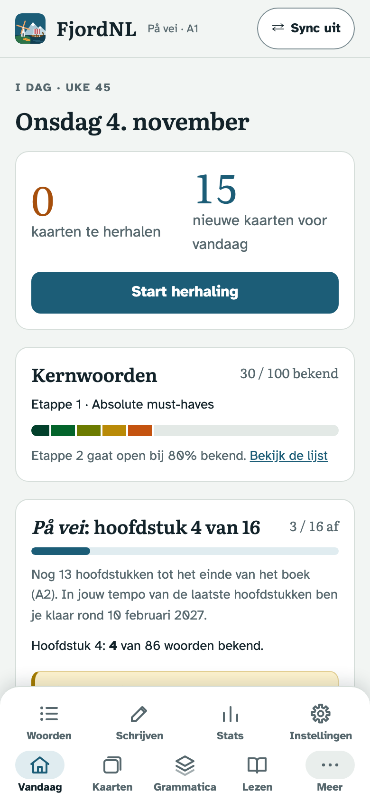

Hoe je oefent, lees je hieronder bij [Kaarten](#kaarten-de-eerste-keer), [Grammatica](#grammatica-het-leerpad), [Lezen](#lezen) en [Stats](#stats). Met de knop **Sync** koppel je je apparaten; zie [Sync](#sync-je-apparaten-koppelen).

## Kaarten: de eerste keer

**Rondleiding.** De eerste keer dat je **Kaarten** opent, staat er in plaats van de stapels een korte rondleiding in drie stappen: een oefenkaart die je omdraait en opzij veegt, wanneer een kaart terugkomt, en hoeveel nieuwe kaarten je per dag krijgt. De oefenkaart telt nergens mee. Met **Overslaan** ga je meteen naar de stapels. Terugzien: onderaan **Kaarten**, *Bekijk de rondleiding*, of bij **Instellingen → Zo leer je het snelst**.

1. Ga naar **Kaarten** en druk op **Start**. Je ziet een Noors woord. Bedenk wat het betekent en zeg het hardop.
2. Tik op de kaart of op **Toon antwoord**.
3. Kies **Wist ik** of **Wist ik niet**. Je kunt de kaart ook opzij vegen, waar je hem ook vastpakt, met je vinger of met de muis of het trackpad: naar rechts is **Wist ik**, naar links is **Wist ik niet**. Pas als je de kaart een flink stuk opzij trekt (ongeveer een derde van de breedte), verschijnen het label en de kleur; laat je eerder los, dan veert de kaart terug naar het midden. Een snelle veeg telt ook.
4. De app bepaalt zelf wanneer je de kaart weer ziet, met FSRS, de planner die ook in Anki zit. Wist je het niet, dan komt de kaart in dezelfde ronde terug. Een nieuwe kaart die je wist, zie je vandaag nog één keer, en daarna steeds later: na ongeveer 2 dagen, 11 dagen en 2 maanden. De app kiest het moment waarop je het woord met 9 op 10 kans nog weet. Na elke kaart staat bovenaan wanneer hij terugkomt, en zodra je hem een paar dagen onthoudt ook in welk bakje hij zit, van *Aan het leren* tot *Mega goed*.

**Verkeerde kant op?** Na elke kaart staat bovenaan wat je koos. Klopt dat niet, tik dan op **Herstel**: dezelfde kaart komt terug, omgedraaid, en je kiest opnieuw. Herstel gaat één stap terug, naar je laatste keuze. Was dat de laatste kaart van je sessie, dan staat **Herstel** in *Klaar voor nu*. De kaart komt terug uit de kant waar je hem heen veegde.

**Met het toetsenbord:**

| Toets | Wat gebeurt er? |
| --- | --- |
| spatie of Enter | de kaart draait om |
| → of 2 | **Wist ik** |
| ← of 1 | **Wist ik niet** |
| Enter, op de achterkant | **Wist ik**: twee keer Enter is dus omdraaien en **Wist ik**. Na een fout getypt antwoord kiest Enter wat de app voorstelt (**Wist ik niet**) |
| spatie, op de achterkant | **Wist ik niet**: twee keer spatie is dus omdraaien en **Wist ik niet** |
| Ctrl Z of ⌘ Z | **Herstel**: je laatste keuze terug |
| ? | overzicht van de sneltoetsen (ook met het knopje **Sneltoetsen** boven de kaart) |

Terwijl je typt, doen de sneltoetsen niets. Op een computer zie je het overzicht één keer vanzelf, bij je eerste kaarten. Op een telefoon of tablet laat een bewegende kaart de eerste keer zien hoe vegen werkt, op elk apparaat één keer. Deed je de rondleiding, dan komen het overzicht en de bewegende kaart niet meer: die heb je al gezien.

**Welke kant op?** Bovenaan elke kaart staat de richting, in tekst en in kleur: **Noors → Nederlands** in petrol (je ziet een Noors woord en zegt wat het betekent), **Nederlands → Noors** in oranje (je maakt zelf het Noors). Ook de rand bovenaan de kaart heeft die kleur.

**Even iets anders?** Je sessie blijft bewaard: als je naar een ander onderdeel gaat, de app herlaadt of je telefoon hem op de achtergrond afsluit. Zo lang je sessie loopt, staat bovenaan elk ander onderdeel **← Terug naar kaarten**, en het tabblad **Kaarten** heeft een getal: zoveel kaarten komen er nog. Je gaat verder bij dezelfde kaart, aan dezelfde kant. De link **Grammatica: …** op de achterkant opent in hetzelfde venster. Elke beoordeling bewaart de app meteen. Een sessie loopt tot middernacht; de volgende dag begin je met een nieuwe rij.

**Nieuwe kaarten per dag.** Bij **Instellingen → Nieuwe kaarten per dag** zie je hoeveel nieuwe kaarten je vandaag al begon. Zet je de instelling hoger of lager, dan telt dat mee: met 20 nieuwe kernwoorden en 10 al gedaan, komen er nog 10 bij. Herhalingen tellen hier niet mee: die komen er los bij. Daarom kun je op een dag 70 kaarten beoordelen met maar 15 nieuwe.

**Wat staat er op de achterkant?**

- de Nederlandse betekenis;
- het Noorse woord met de woordsoort. Bij een zelfstandig naamwoord zie je of het een en-, ei- of et-woord is, met de vier vormen;
- bij een werkwoord de vier vormen: het hele werkwoord, nu, verleden en voltooid, bijvoorbeeld *gå, går, gikk, gått*. Een onregelmatige vorm valt op, met **Let op: onregelmatig**: die leer je uit je hoofd;
- voorbeeldzinnen met vertaling en uitspraak;
- bij kleine woorden, zoals voegwoorden, de hele groep, met een link naar de grammatica.
- een kader als een Nederlands woord in het Noors twee of meer woorden is (*of*: *om* of *eller*), met een zin bij elk woord; bij een voegwoord het kader *Bijzin erna*;
- bij woorden die van klank wisselen (*gi*, *gir*, *ga*, *gitt*), onder de vormen hoe elke vorm klinkt.

Tik op een woord in een Noorse zin. Je ziet dan de basisvorm, de woordsoort, welke vorm het is, de betekenis en de uitspraak. Bij sommige zinnen staat bij *Waarom* waarom het woord die vorm heeft, zoals *liten* in *Da jeg var liten*.

**Typen.** Bij kaartjes van Nederlands naar Noors typ je het antwoord. Klik daarna op **Controleer**. Voor æ, ø en å staan knoppen naast het invulveld. Heeft het Nederlandse woord meer dan één Noors woord (*goed*: *god* of *bra*), dan staat onder de vraag welke betekenis bedoeld is. Typ je een ander Noors woord voor hetzelfde Nederlandse woord, dan zegt de app wanneer jouw woord hoort (*Jij typte: god (bij een woord)*); een echt synoniem telt als goed (*Ook goed: frem*).

**Vormen oefenen.** Ken je een woord een week goed, dan kan de app ook de vormen overhoren: *å gjøre → gjorde*, *en mann → menn*, *hus → huset*. Dat staat uit tot je het aanzet. Ken je genoeg woorden, dan staat bij **Kaarten** de stapel **Vormen**, met *uit* (rood) of *aan* (groen). Tik erop en kies **Aanzetten**; onder **Start** kies je daarna met vinkjes welke vormen je oefent. Het kan ook bij **Instellingen → Vormen oefenen** of met de uitnodiging op **Vandaag**.

- Je kiest zelf wat je oefent: **Werkwoorden**, **Meervoud**, **Geslacht**, **Bijvoeglijk naamwoord** en **Trappen**.
- Een vormkaart toont het woord en vraagt één vorm, bijvoorbeeld *Verleden tijd? «i går …»*. Bedenk de vorm, draai de kaart om en kies **Wist ik** of **Wist ik niet**. Je typt niets.
- Op de achterkant staan alle vormen van het woord. Het gevraagde vak is geel, met **deze kaart**. Staat er **Ook goed**, dan is die vorm ook juist: *stod* naast *sto*, *boken* naast *boka*.
- Je krijgt eerst alleen vormen die je per woord moet onthouden. Met **Ook vormen volgens een regel** komen er per regel tien voorbeeldwoorden bij, uit de woorden die je kent.
- De kaarten tellen mee bij **Andere kaarten** per dag. Ze staan tussen je andere kaarten in **Alle stapels**, en apart in de stapel **Vormen**. Reken op ongeveer vijf minuten per dag erbij.
- Heb je vandaag al een kaart van een woord gedaan, dan komt de vormkaart van dat woord een andere dag. Zo zie je het antwoord niet vlak ervoor.
- **Uit** is pauze: wat je leerde, blijft bewaard. Zet je een soort na lange tijd weer aan, dan staan er eerst veel herhalingen klaar.

**Vaste voorzetsels (B2).** Voor gevorderden staat bij **Kaarten** de stapel **Vaste voorzetsels**: kaarten met *glad i*, *stolt av*, *glede seg til* en meer: je ziet de zin met een gat en tikt het voorzetsel aan (je kunt nog wisselen); pas met **Bevestigen** telt het. Met een toetsenbord: typ de eerste letter en druk op Enter. Nieuwe kaarten krijg je als je die stapel kiest, en vanaf etappe *Verdieping 1* ook vanzelf in **Alle stapels** (binnen *Andere kaarten* per dag); herhalingen komen ook in **Alle stapels**. Een vriend stuur je er meteen heen met de link https://fjordnl.nl/#kaarten/vaste-voorzetsels. Uitleg en oefeningen staan bij **Grammatica**, in het blok B2.

**Werk je met het lesboek *På vei*?** Klik bij **Vandaag** op **Hoofdstuk 1 afgerond** als je dat hoofdstuk af hebt. Daarna staat er **Hoofdstuk 2 afgerond**, enzovoort. Ben je al verder? Klik dan door tot het hoofdstuk waar je nu bent.

- De nieuwe kaarten komen dan eerst uit de hoofdstukken tot en met jouw hoofdstuk, per thema. Daarna gaat het verder in de gewone volgorde. Bij **Nieuwe kaarten eerst uit hoofdstuk …** zet je dat aan of uit.
- Bij het boek zie je per hoofdstuk hoeveel woorden je al kent.
- Op een kaartje uit het boek staat het thema en de paragraaf, bijvoorbeeld *Thema · De klok kijken · På vei 3.1*. Op de achterkant zie je het hele groepje.
- Ook uitdrukkingen uit het boek, zoals *stå opp* en *glede seg*, komen als kaartje.

## Grammatica: het leerpad

1. Open **Grammatica**. Je ziet je volgende stap en het leerpad: eerst het blok **Uitspraak** (alfabet, klanken, stomme letters en getallen), dan per niveau (A1, A2, B1), daarna het blok **Zinsbouw en stijl** (B1/B2 en hoger) en het blok B2 met **Vaste voorzetsels**.
2. Tik op een onderdeel. Er zijn vier tabjes: **Uitleg**, **Voorbeelden**, **Oefenen** en **Spiekbrief**.
3. Lees de **Uitleg**. Het kader *Nederlanders opgelet* laat zien waar het Nederlands je op het verkeerde been zet.
4. Luister naar de **Voorbeelden**. Tik op een woord voor meer uitleg.
5. Ga naar **Oefenen**. Alles werkt ook met het toetsenbord. Geldige Bokmål-varianten, zoals *jenta* en *jenten*, tellen als goed.
6. Bij elk onderdeel zie je hoe goed je het beheerst. Een fout komt als extra kaart terug bij **Kaarten**, in de stapel **Mijn fouten**.
7. Werk je met *På vei*? Bij elk onderdeel staat bij welk hoofdstuk het past. De onderdelen tot en met het hoofdstuk waar je bent, zijn gemarkeerd met *in je boek*.

Iets beleefd vragen (*Kan jeg få …?*, *Kunne jeg fått …?*) leer je in **Beleefd vragen en wensen** (A2), direct na de modale werkwoorden. Daar wisselen de oefenrondes: eerst kiezen en zinnen bouwen, dan fout zoeken en typen.

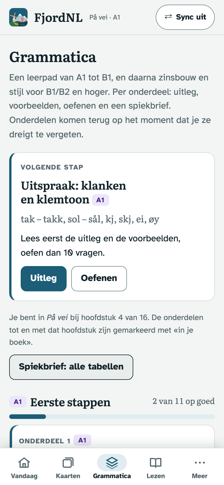
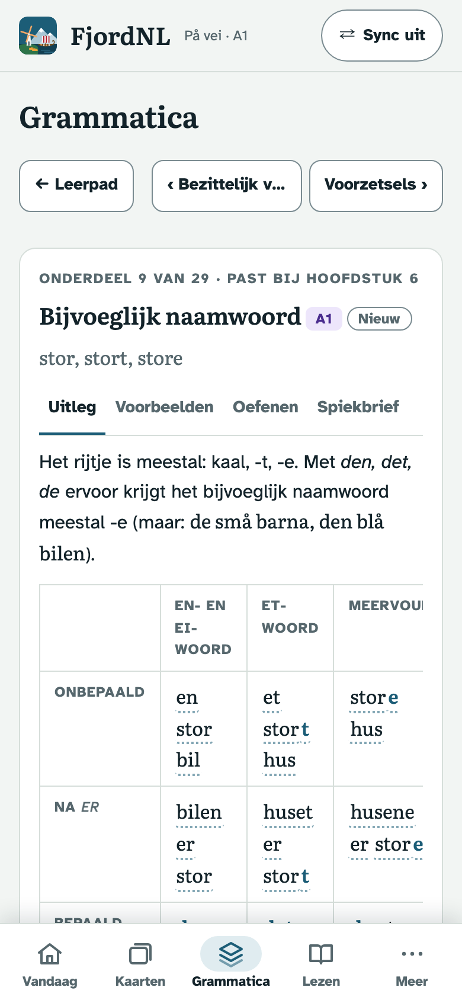

**Tien soorten vragen:**

- **kiezen** uit een paar antwoorden;
- **typen**: vul het ontbrekende woord in;
- **zinnen bouwen**: zet de woorden in de goede volgorde;
- **omzetten**: zet een zin bijvoorbeeld van nu naar verleden tijd;
- **fout zoeken**: tik op het foute woord en verbeter het;
- **dictee**: luister naar een zin en typ hem;
- **luisteren en kiezen**: welk woord hoor je, bijvoorbeeld *tak* of *takk*?
- **stomme letters aantikken**: welke letter zeg je niet, zoals de h in *hvem*?
- **welk getal hoor je**: kies uit drie getallen die op elkaar lijken, zoals 17, 70 en 77;
- **getallen opschrijven**: luister en schrijf het getal met cijfers.

Bij een keuzevraag tik je eerst een antwoord aan (dat mag je nog veranderen) en daarna **Bevestigen**, of je drukt op Enter. Met het toetsenbord kies je met de cijfers 1, 2, 3. Bij *Vaste voorzetsels* oefen je één soort vraag: het voorzetsel kiezen (met het toetsenbord: de eerste letter).

**Uitspraak.** Bij *Alfabet en spellen* tik je op een letter en hoor je de naam. Bij *Uitspraak* en *Stomme letters* staan bij Voorbeelden alle regels op een rij, met een opname bij elk woord. Bij *Getallen* hoor je de getallen die op elkaar lijken naast elkaar.

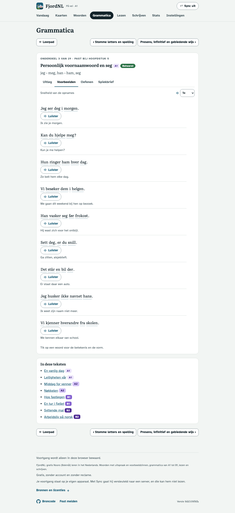
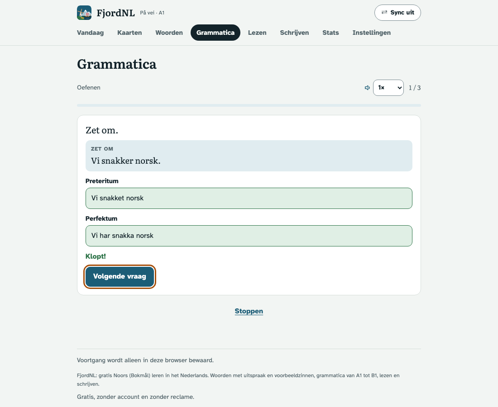
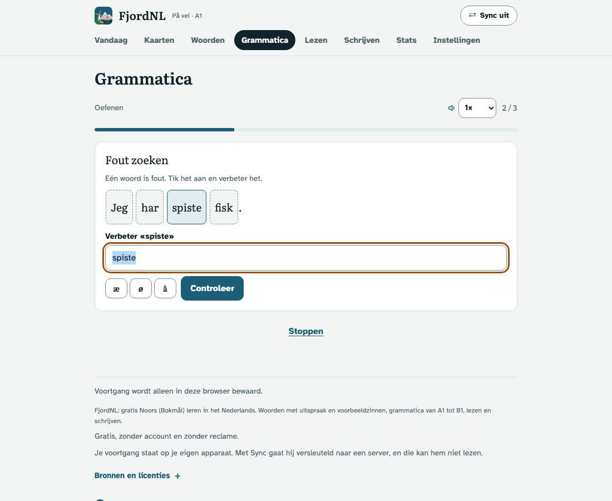
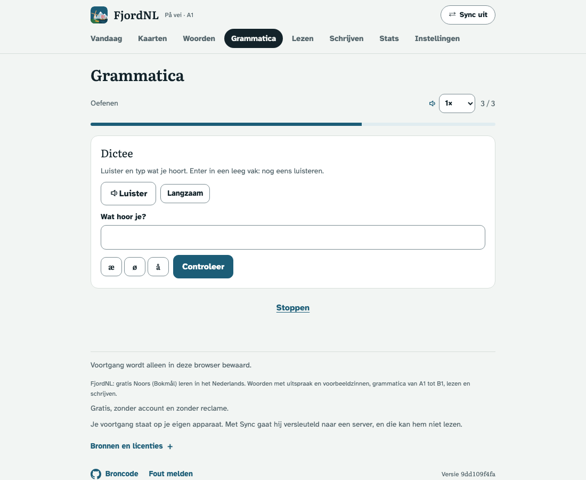

**De spiekbrief** heeft alle tabellen op één plek. Je zoekt erin op een Noors of Nederlands woord. Je mag æ, ø en å typen als a, o en a.

**Toetsen.** Bij **Grammatica** staan ook 4 toetsen, die stap voor stap opbouwen. Een fout in een toets komt ook als extra kaart terug.

## Lezen

1. Open **Lezen**. Kies een niveau (A1 tot B2), een lengte en eventueel een thema.
2. Tik op **Nieuwe tekst**. Je kunt ook zelf een tekst uit de lijst kiezen.
3. Lees de tekst. Met **Lees alles voor** hoor je de tekst zin voor zin. Je kunt ook de vertaling onder elke zin laten zien.
4. Tik op een zin. Het **zinvel** opent, met vier tabjes:
   - **Vertaling**;
   - **Grammatica**: de vormen van elk werkwoord, de woordvolgorde en links naar het leerpad;
   - **Stijl**: uitdrukkingen en hoe je iets zegt;
   - **Woorden**: elk woord met zijn betekenis.
5. Ken je een woord nog niet? Tik bij **Woorden** op **Naar mijn kaarten**. Het woord komt dan als volgende nieuwe kaart in je stapel. Met **Eigen kaart** maak je er een eigen kaart van.
6. Aan het eind beantwoord je 7 of 8 vragen over de tekst. Bij A1 en A2 zijn de vragen in het Nederlands. Bij B1 en B2 zijn ze in het Noors, met een knop **Vertaal**. Na elk antwoord zie je de zin uit de tekst waar het antwoord staat.

Je beste score per tekst bewaart de app. Die gaat mee in Sync en in de back-up.

## Stats

**Stats** laat zien hoe goed je je woorden kent. Bekend is een woord dat je na een pauze van een paar dagen nog wist (vanaf *Wankel*); daarvoor is het *Aan het leren*. Een etappe gaat open als 80% van de vorige bekend is. Wijs of tik op een gekleurde balk voor de aantallen. Tik op een woord in *Ken je het best* of *Lastigste woorden* om de kaart te zien. Met **Trollenjacht** oefen je je lastigste woorden nog één keer. **Hoe telt de app?** legt uit hoe de getallen werken.

**Oefentijd** toont hoeveel tijd je oefent per dag, week, maand en jaar. Kaarten, grammatica, lezen en schrijven tellen vanzelf mee; ander oefenen zet je bij **Vandaag** onder *Deze week* (+15 of +30 min).

## Back-up: je voortgang bewaren

Je voortgang staat alleen op je apparaat. FjordNL is een website die werkt als app: de pagina en de opnames komen van fjordnl.nl, maar je voortgang verlaat je apparaat niet (met Sync gaat er een versleutelde kopie naar de server). Bovenaan **Instellingen**, bij **Waar staat je voortgang?**, staat precies waar hij staat. Maak af en toe een back-up. Is je laatste back-up ouder dan een week, dan herinnert de app je eraan op **Vandaag**.

**Anoniem meetellen.** Eén keer per dag telt de website anoniem mee: dat je FjordNL gebruikte, je etappe, ongeveer hoeveel woorden je kent, en of je Sync en de app op je beginscherm gebruikt. Er gaat geen id, cookie of kaart mee, en je IP-adres wordt niet bewaard. Liever niet? Zet bij **Instellingen → Waar staat je voortgang?** de schakelaar **Anoniem meetellen** uit (rood). Dat geldt voor dat apparaat.

**Back-up maken**

1. Ga naar **Instellingen**.
2. Klik bij **Waar staat je voortgang?** op **Back-up maken**.
3. Je krijgt een bestand, bijvoorbeeld `norsk-ovebok-voortgang-2026-11-04.json`. Het komt in je map met downloads. Bewaar het goed, bijvoorbeeld in je cloudopslag.

**Back-up terugzetten**

1. Open de app op het apparaat waar je verder wilt.
2. Ga naar **Instellingen** en klik bij **Waar staat je voortgang?** op **Back-up terugzetten**.
3. Kies het bestand.

De app voegt de back-up samen met wat er al op het apparaat staat. Per kaart blijft de laatste herhaling bewaard. Je verliest dus niets.

**Naar een ander apparaat, zonder Sync?** Kies bij **Instellingen** voor **Deel back-up naar ander apparaat**. Dan opent het deelmenu (AirDrop, WhatsApp, mail). Op het andere apparaat kies je **Back-up terugzetten**.

**Kopie van vóór een update.** Komt er een nieuwe versie van FjordNL, dan bewaart de app eerst een kopie van je voortgang op dit apparaat (van de laatste vijf dagen met een update). Is er na een update iets weg? Open bij **Instellingen → Waar staat je voortgang?** het blok **Kopie van vóór een update** en kies **Zet terug**. De app voegt de kopie samen met wat er nu staat, dus ook hier verlies je niets. Met **Download** bewaar je de kopie als back-upbestand. De kopie staat op hetzelfde apparaat en gaat mee weg als de browser alles wist: hij vervangt geen back-up en geen Sync.

**Wanneer is je voortgang weg?**

- als je de gegevens van je browser wist;
- als je de app van je beginscherm verwijdert;
- in een privévenster, zodra je het venster sluit;
- op een iPhone of iPad in de browser, en in Safari op een Mac, als je de website 7 dagen niet gebruikt. Met Sync en je koppelcode als wachtwoord haal je alles terug (zie [Sync](#sync-je-apparaten-koppelen));
- in de browser van een andere app (WhatsApp, Gmail, de Google-app, Instagram): die app kan alles wissen. Open FjordNL daarom in je eigen browser.

Verplaats je de map van de bestandsversie? Maak dan eerst een back-up. Je browser ziet een verplaatste map als een andere plek.

**Opnieuw beginnen.** Ga naar **Instellingen → Opnieuw beginnen** en kies **Voortgang wissen**. Twijfel je, maak dan eerst een back-up: die knop staat erbij. Gebruik je Sync, dan kies je:

- **Op al je apparaten**: je voortgang wordt overal gewist. Je kunt dat nog een paar seconden ongedaan maken.
- **Alleen op dit apparaat**: dit apparaat stopt dan met synchroniseren. Anders komt je oude voortgang terug van je andere apparaten.

## Sync: je apparaten koppelen

Oefen je op meer dan één apparaat? Koppel ze één keer met **Sync**. Daarna houdt de app je voortgang vanzelf gelijk. Je hebt geen account nodig: een geheime **koppelcode** van 8 tekens (zoals `XXXX-XXXX`) doet dat werk. Sync werkt in de website en in de app op je beginscherm, niet in de bestandsversie.

Je kunt op vier manieren beginnen:

- Kies **Sync instellen** in de vraag *Leer je ook op een ander apparaat?*. Die komt na **Klaar** op de welkomstkaart, en daarna hoogstens één keer per dag als je de app opent, zolang Sync uit staat. Vink je **Niet meer tonen** aan, dan komt hij niet meer.
- Tik op de knop **Sync**.
- Kies **Instellen** bij de uitnodiging op **Vandaag**. Die zie je als je 10 kaarten hebt geoefend.
- Ga naar **Instellingen → Synchroniseren instellen**.

**Op je eerste apparaat** (bijvoorbeeld je laptop)

1. Tik op **Sync**. Lees de uitleg en tik op **Verder**.
2. Kies **Mijn eerste apparaat**.
3. Je ziet een QR-code en de koppelcode. Kies bij **Wat voor apparaat is je andere apparaat?** je telefoon of computer. Daar staat precies wat je moet doen.
4. Laat dit scherm openstaan. Het ziet vanzelf wanneer je andere apparaat gekoppeld is. Wil je je andere apparaat later koppelen? Dan vind je de code terug: tik op **Sync** en kies **Koppel nog een apparaat**.

**Op je tweede apparaat** (bijvoorbeeld je telefoon)

1. Open de app, tik op **Sync** en daarna op **Verder**.
2. Kies **Ik synchroniseer al op een ander apparaat**.
3. Kies een van de drie:
   - **Scan de QR-code**: tik op de knop en richt de camera op de QR-code van je eerste apparaat. Deze knop zie je alleen in Chrome, op Android en op een Mac.
   - **Typ de koppelcode over** (8 tekens) en tik op **Koppelen**. Kleine letters mogen ook, en het streepje komt vanzelf. In de code staan nooit O, 0, I of 1: typ je er een, dan zegt de app dat meteen.
   - **Uit je wachtwoorden**: heb je de koppelcode als wachtwoord bewaard, tik dan op het veld onder **Koppelcode als wachtwoord bewaard?** en kies hem. De app koppelt meteen.
4. Je ziet **✓ Gekoppeld**. De voortgang van beide apparaten is samengevoegd. Ook je eerste apparaat meldt nu dat het gelukt is.

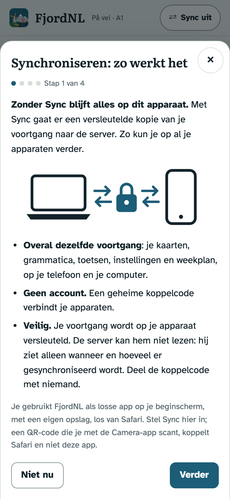
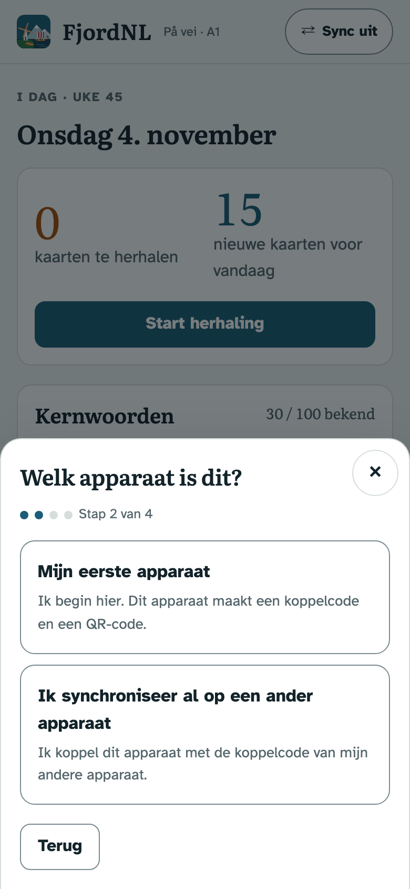
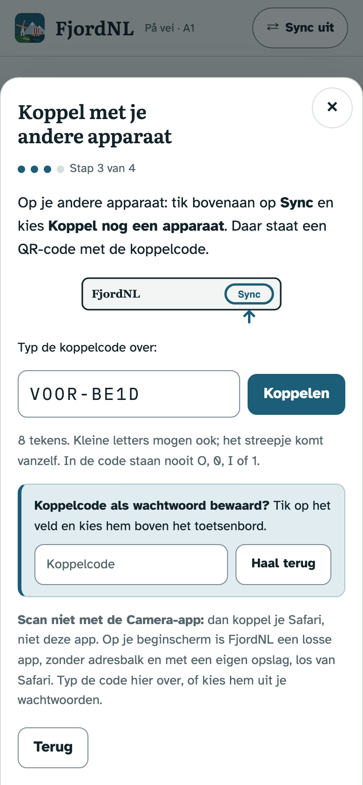
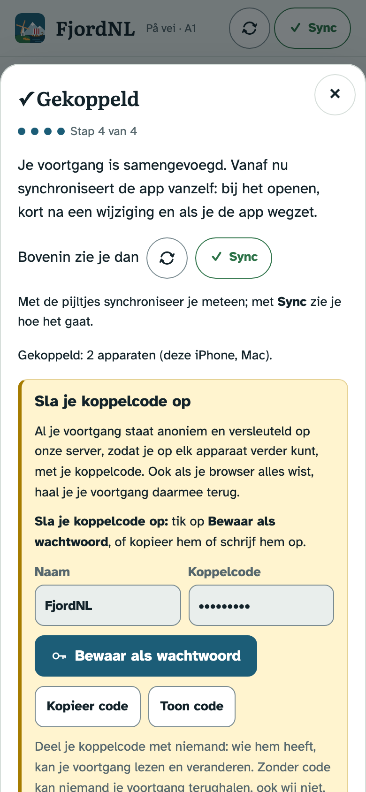

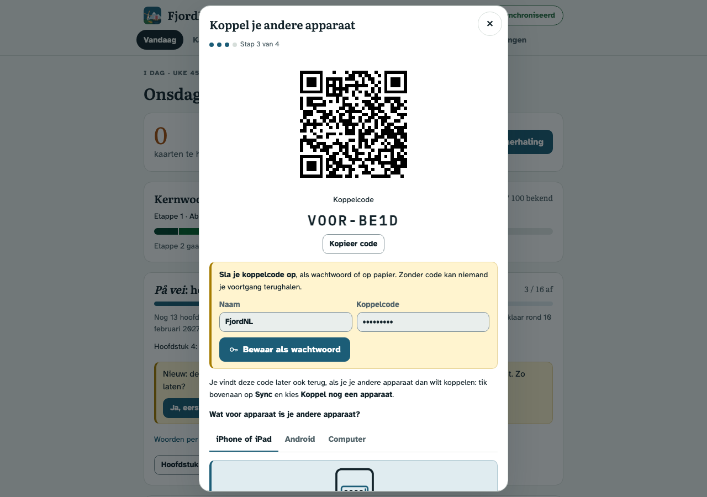

**Scan je met de gewone camera van je telefoon?** Dan opent de app met de vraag **Dit apparaat koppelen?** Tik op **Koppel dit apparaat**.

**Sla je koppelcode op.** Al je voortgang staat anoniem en versleuteld op onze server, zodat je op elk apparaat verder kunt, met je koppelcode. Zonder code kan niemand je voortgang terughalen, ook wij niet. Tik bij de QR-code, bij **✓ Gekoppeld** of later bij **Sync** op **Bewaar als wachtwoord**. Opschrijven kan ook: tik op **Toon code**. Je browser vraagt dan of hij het wachtwoord mag bewaren (in Safari: **Bewaar wachtwoord**, in Chrome: **Opslaan**). In Safari laadt de app daarbij even opnieuw; je voortgang blijft gewoon staan. De naam is *FjordNL*, het wachtwoord is je koppelcode. Vraagt je browser niets, kopieer de code dan en bewaar hem zelf.

**iPhone of iPad in Safari?** Gebruik je de app 7 dagen niet, dan wist Safari alles wat de app op je iPhone bewaart, ook je koppelcode. Dat geldt ook voor andere browsers op iPhone en iPad, en voor Safari op een Mac. Je voortgang staat dan nog veilig op de server. Heb je de koppelcode als wachtwoord bewaard, dan haal je hem met één tik terug:

1. Is alles gewist, dan staat op **Vandaag** weer de welkomstkaart, met bovenin **Al eerder gebruikt? Haal je voortgang terug**. Tik daarop. Heb je de code opgeschreven, tik dan op **Typ de code over**.
2. Tik op het codeveld en kies je opgeslagen wachtwoord boven het toetsenbord.
3. De app koppelt meteen en haalt je voortgang terug van de server.

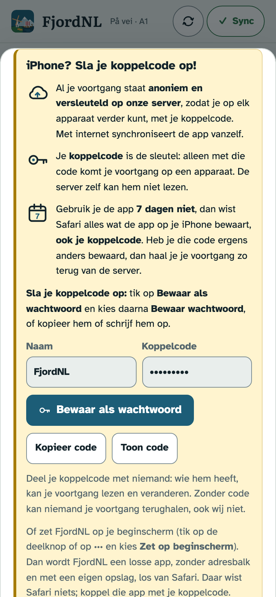
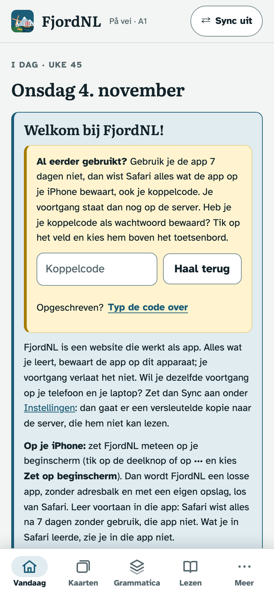

Op het beginscherm geldt de regel van 7 dagen niet. De app op je beginscherm bewaart je voortgang wel apart van Safari. Gebruik je die app, stel Sync dan dáár in en typ de koppelcode daar over. Scan niet met de Camera-app: die opent de koppeling in Safari, en dan koppel je alleen Safari.

**Daarna gaat het vanzelf.** De app synchroniseert bij het openen, na een wijziging (als je even niets doet, en niet midden in een kaartsessie) en als je de app sluit. Alleen wat er veranderd is, gaat naar de server. Meestal is dat een paar kilobyte. Alles gaat mee: kaarten, instellingen, eigen woorden, grammatica, toetsen, leesscores en je weekplan. Per kaart telt de laatste herhaling.

Op de knop **Sync** zie je hoe het gaat:

- een vinkje (✓): alles is gelijk;
- een draaiend icoon: de app is bezig;
- **Offline**: je hebt geen internet. De app synchroniseert vanzelf zodra je weer internet hebt;
- een waarschuwing (⚠): het lukte niet.

Links ervan staat een ronde knop met twee pijltjes: **Synchroniseer nu**. Tik erop, dan synchroniseert de app meteen. De pijltjes draaien tot het klaar is; daarna zie je kort een vinkje (✓), of een melding als het niet lukte.

Tik op de knop **Sync** voor meer. Daar zie je ook welke apparaten gekoppeld zijn.

**Nog een apparaat koppelen?** Tik op een gekoppeld apparaat op **Sync** en kies **Koppel nog een apparaat**. Je ziet dan opnieuw de QR-code en de koppelcode.

**Veilig.** Je voortgang wordt op je apparaat versleuteld met de koppelcode. De server kan je voortgang niet lezen; hij ziet alleen wanneer en hoeveel er gesynchroniseerd wordt. Deel de code met niemand: wie de code heeft, kan je voortgang lezen en veranderen. Bewaar hem wel als wachtwoord (zie hierboven). Dan haal je je voortgang terug, ook als je al je apparaten kwijt bent.

**Stoppen.** Tik op **Sync** en kies **Ontkoppel dit apparaat**. Dat apparaat stopt met synchroniseren. Je voortgang blijft er gewoon staan.

**Gegevens op de server wissen.** Ga naar **Instellingen → Gegevens op de server wissen…**, of tik op **Sync** en kies **Ontkoppel en wis van de server**.

- De app wist je versleutelde voortgang van de server. Heb je geen internet, dan gebeurt dat zodra je weer online bent.
- Je andere apparaten stoppen bij hun volgende synchronisatie.
- Op elk apparaat blijft je voortgang gewoon staan.

Voortgang die een jaar lang niet is gesynchroniseerd, wist de server vanzelf.

## Problemen oplossen

**Ik zie geen knop om te installeren.** Gebruik Chrome of Edge op een computer, Safari op een iPhone of Chrome op Android. Laad de pagina opnieuw. In een privévenster kun je niet installeren.

**Mijn voortgang is weg.** Kijk of je de app op dezelfde manier opent als eerst. Op een iPhone en in het Dock van een Mac heeft de app zijn eigen gegevens, apart van Safari. Op een iPhone of iPad in Safari kan Safari alles gewist hebben na 7 dagen zonder bezoek: tik dan in de welkomstkaart op **Vandaag** op **Haal je voortgang terug**, tik op het codeveld en kies je opgeslagen koppelcode. Ging er iets mis na een update? Kijk dan bij **Instellingen → Kopie van vóór een update**. Is je voortgang echt weg? Zet dan je laatste back-up terug. Gebruik je Sync? Koppel dit apparaat dan opnieuw met je koppelcode: je voortgang komt terug van de server.

**Ik zie een oude versie.** Normaal hoeft dat niet: kom je terug in de app, dan kijkt hij of er een nieuwe versie is, en laadt hij die vanzelf. Dat doet hij het liefst op het moment dat je naar een ander onderdeel gaat, en anders als je even niets doet. Hij wacht zolang je typt, er een venster openstaat, geluid speelt of Sync bezig is, en zolang je op Kaarten een sessie doet of een grammaticaronde maakt. Daarna staat er even *FjordNL is bijgewerkt*. Je kaartsessie en wat je half typte, blijven. Open je de app opnieuw, dan kan Safari heel even de vorige versie laten zien; de app laadt dan meteen zelf de nieuwe. Zie je toch nog een oude versie, sluit de app dan helemaal af en open hem opnieuw.

**Ik hoor niets.** Staat het geluid van je apparaat aan? Heb je geen internet, dan hoor je alleen de opnames die je hebt gedownload (zie [Uitspraak zonder internet](#uitspraak-zonder-internet)); het lampje bovenin is dan rood. Zonder opname gebruikt de app de Noorse stem van je apparaat, als die er is.

**Bij Waar staat je voortgang? staat Niet beschermd.** Dan mag je browser je voortgang wissen als je schijf of telefoon vol raakt. Chrome en Edge vragen je daar niets over: ze geven de bescherming vanzelf aan een site die je als app installeert of vaak gebruikt. De app vraagt het bij elk openen opnieuw, en met **Vraag om bescherming**.
- Installeer FjordNL als app (zie [Welk apparaat heb je?](#welk-apparaat-heb-je)) en open hem als app.
- Installeerde je de app vóór de verhuizing naar fjordnl.nl (4 november), toen hij nog op platypus45.github.io stond? Die app hoort bij het oude adres. Installeer FjordNL opnieuw vanaf <https://fjordnl.nl/>. Zet eerst Sync aan of maak een back-up, en wis bij het verwijderen van de oude app niet je gegevens.
- Wist je browser cookies en sitegegevens als je hem sluit? Dan geeft hij geen bescherming, en verdwijnt je voortgang bij het sluiten. Zet fjordnl.nl bij de uitzonderingen. Dat staat in de privacy-instellingen van je browser, bij cookies en sitegegevens.
- Firefox vraagt het jou: kies **Toestaan**.

Tot dan: zet Sync aan of maak af en toe een back-up.

**Werkt de app zonder internet?** Ja, als je hem één keer met internet hebt geopend. Synchroniseren gebeurt dan zodra je weer internet hebt.

**Koppelen lukt niet: "Deze koppelcode is niet bekend".** Controleer de code letter voor letter. Klopt hij? Tik dan op je eerste apparaat bovenin op de knop met twee pijltjes (**Synchroniseer nu**). Pas daarna staat je voortgang op de server, en lukt het koppelen.

**"Geen verbinding met de sync-server", of Sync lukt steeds niet.** Controleer je internetverbinding. Je voortgang blijft gewoon op je apparaat staan. De app synchroniseert vanzelf als de verbinding er weer is.

**"Je oude koppelcode werkt niet meer".** Had je al gekoppeld met een oudere versie van de app? Synchroniseren is vernieuwd en nu versleuteld. Tik op één apparaat op **Sync**, stel Sync opnieuw in en koppel daarna je andere apparaten. Je voortgang blijft staan.

**Een vertaling klopt niet.** Je kunt hem voor jezelf aanpassen: zoek het woord bij **Woorden** en klik op **Bewerk**. Meld het ook bij [Issues](https://github.com/platypus45/fjordnl/issues/new/choose), met het formulier *Foute vertaling* (met een gratis GitHub-account). Dan verbeteren we het voor iedereen.

**Werkt het nog steeds niet?** Maak een melding bij [Issues](https://github.com/platypus45/fjordnl/issues/new/choose).
